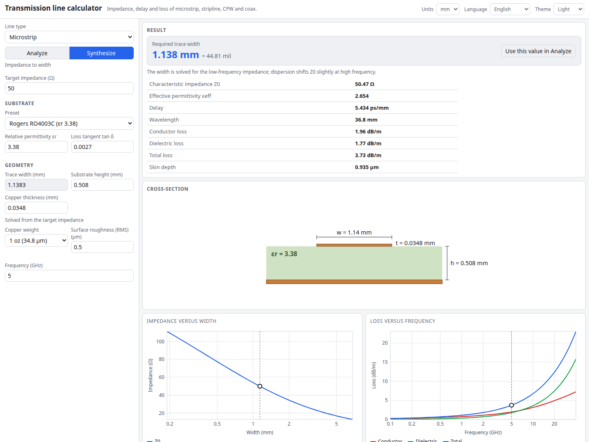

# Transmission Line Calculator

Impedance, delay and loss for the lines on a PCB or in a cable. Pick microstrip, stripline, coplanar waveguide (with or without a ground plane), edge-coupled microstrip or coax, enter the geometry and get Z0, effective permittivity, delay, wavelength and conductor and dielectric loss. Or switch to Synthesize, enter a target impedance and get the trace width. A cross-section drawing follows every change, and two plots show Z0 against width and loss against frequency.

**Try it: [hermes98761234.github.io/transmission-line-calculator](https://hermes98761234.github.io/transmission-line-calculator/)**

[](https://github.com/hermes98761234/transmission-line-calculator/actions/workflows/deploy.yml)



## Features

- **Six line types.** Microstrip, symmetric stripline, coplanar waveguide, coplanar waveguide with ground, edge-coupled microstrip (even and odd mode, differential and common-mode impedance) and coax.
- **Analyze and Synthesize.** Geometry to Z0, or target Z0 (differential Z for coupled lines) to width, by bisection.
- **Loss, including roughness.** Conductor loss from the skin effect and the strip's thickness, with the Hammerstad roughness factor, plus dielectric loss. Results in dB/m (or dB/in with mil units).
- **Presets.** FR-4, Rogers RO4003C, RO4350B, RO3003, alumina and PTFE, and copper from 0.5 to 3 oz. Every value stays editable.
- **Live cross-section** drawn to scale, and **plots** of Z0 against width and loss against frequency (hover for values).
- **mm or mil, English or Ukrainian, light, dark or system theme.** Settings are kept in the browser.
- **Nothing to install, no backend.** It is a static page and the numbers never leave your browser.

## How it works

All the maths is in `src/lib` as plain functions with unit tests.

| Line | Model |
| --- | --- |
| Microstrip | Hammerstad-Jensen static Z0 and effective permittivity with the finite-thickness correction; Kirschning-Jansen dispersion of eeff (and a power-current estimate of Z0(f)) |
| Edge-coupled microstrip | Kirschning-Jansen quasi-static even/odd-mode model (valid for 0.1 to 10 for w/h and s/h); strip thickness enters as an effective widening. No dispersion |
| Stripline | Cohn's exact elliptic solution for a thin strip. Thickness through Cohn's fringing term as an effective width. Cross-checked against a finite-difference Laplace solution |
| CPW, CPW with ground | Conformal mapping with elliptic integrals (Simons), Gupta's thickness correction |
| Coax | 60/sqrt(er) ln(D/d) |

**Loss.** Conductor loss uses Wheeler's incremental-inductance rule: R' is the skin-effect resistance times the sensitivity of the air-line impedance to receding every metal surface. That works for any geometry, including the coupled modes. Thin copper (below a few skin depths) is handled with the finite-thickness resistance factor. Dielectric loss uses the filling-factor form `pi f/c * er/sqrt(eeff) * (eeff-1)/(er-1) * tan d`.

**Accuracy.** These are closed-form models, good to a few percent inside their stated ranges. The page warns when you leave a model's range. Use a field solver for critical designs, and remember that real laminates have εr and tan δ that change with frequency.

## Tests

`npm test` checks the formulas against published or independently derived values: K(k) from Abramowitz and Stegun, the HJ air-line impedance at w/h = 1 (126.5 ohm), Pozar's 50 ohm design example (er 2.2, W/h = 3.08), the usual 50 ohm widths on FR-4 and RO4003C, Wheeler's stripline formula, the CPW air line at k = 1/sqrt2 (30 pi ohm), the Cu skin depth, the coaxial loss formula, and limiting cases (wide gap, thick substrate, er = 1). Synthesis is tested as the inverse of analysis for every line type.

## Quick start

You need [Node.js](https://nodejs.org/) 22.

```bash
git clone https://github.com/hermes98761234/transmission-line-calculator.git
cd transmission-line-calculator
npm install
npm run dev       # http://localhost:5173
npm test          # formula, state and i18n tests
npm run build     # static site in dist/
```

## License

MIT
